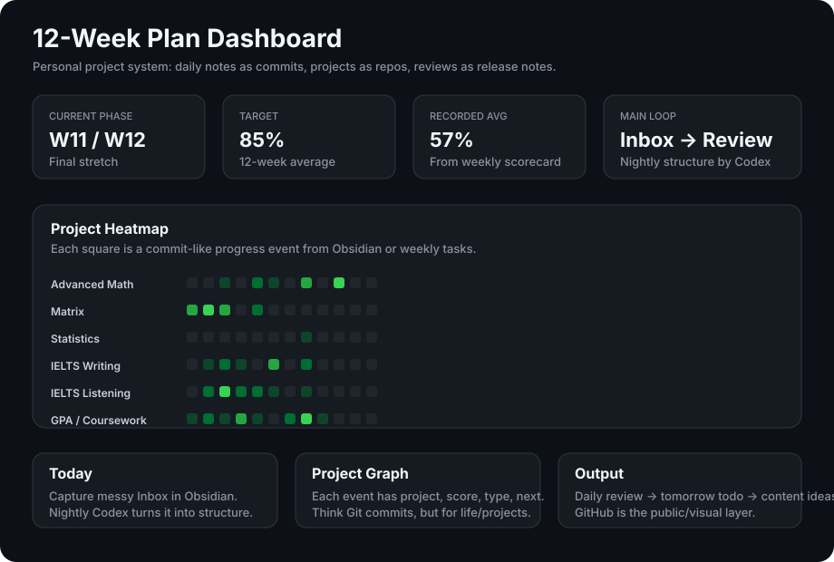

<div align="center">



</div>

## Current System

```text
Obsidian Daily Note  ->  Codex Nightly Review  ->  GitHub Visual Dashboard
raw inbox                structured progress       public/project layer
```

## 12-Week Projects

| Project | Focus |
|---|---|
| Advanced Math | finish learning + mind maps + past papers |
| Matrix | finish learning + mind maps + past papers |
| Statistics | start and build momentum |
| IELTS Writing | biggest score uplift |
| IELTS Listening | full-set review |
| IELTS Speaking | recordings + replay |
| Politics | foundation framework |
| GPA / Coursework | keep coursework from slipping |

## Commit-like Daily Record

```yaml
progress:
  - date: 2026-06-03
    project: IELTS Writing
    score: 3
    type: practice
    message: wrote and revised one Task 2 body paragraph
    next: rewrite with a clearer topic sentence
```

